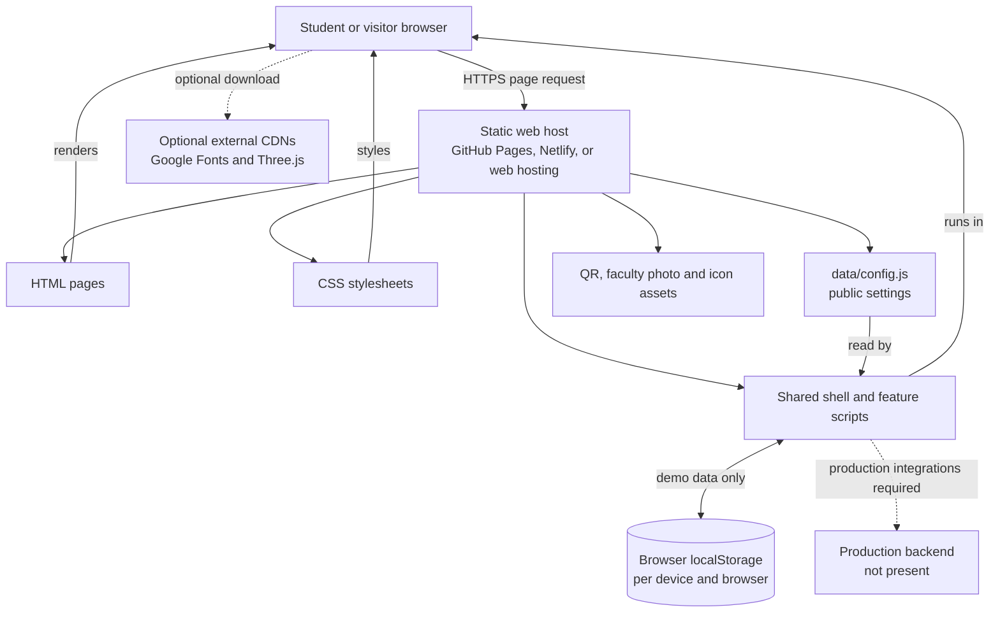
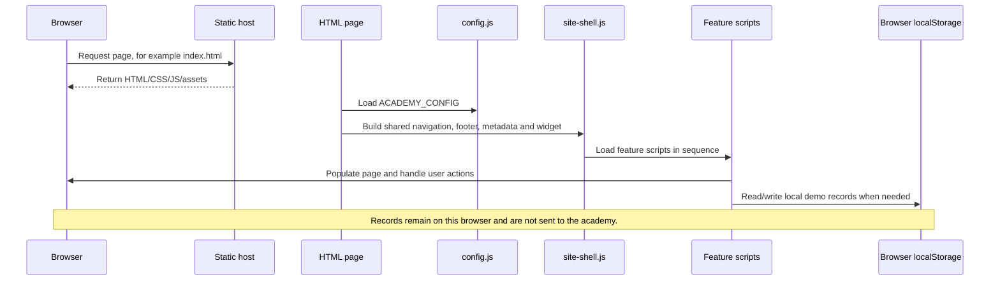
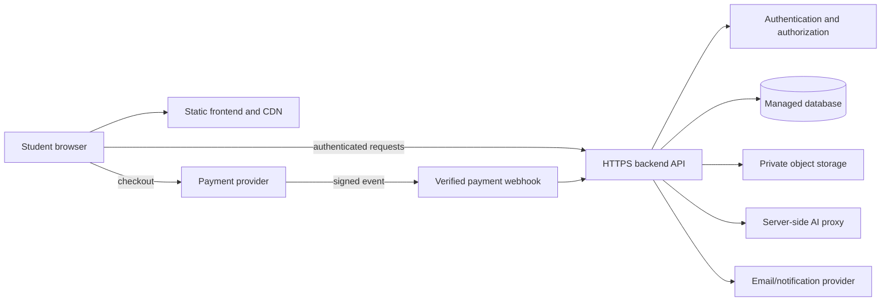

# PHYSX ENGINEER architecture

## 1. At a glance

The current project is a static, browser-run frontend. A static host sends files to a visitor's browser; there is no academy API server or shared database behind this project.

The diagram's `Backend` is a future requirement, not a deployed component. Static hosting alone cannot provide secure accounts, save data to a shared database, verify a UPI transaction, or keep a private API key.

The assistant first fetches `assets/PhysX_AI_Assistant_500_FAQ_Knowledge_Base.json`, generated from the neighboring Excel workbook, and falls back to `data/physx-ai-knowledge-base.json`. It ranks English FAQ records in the visitor's browser. Both datasets are public. The supplied workbook labels entries as needing faculty review, so the UI describes answers as draft study aids rather than verified guidance.

The shared shell loads `js/galaxy-hero.js` on public pages. It adds a decorative canvas to each hero for animated stars, ringed planets, shooting stars, and pointer parallax. Animation runs only while a hero is near the viewport and is disabled for reduced-motion preferences; it does not require WebGL or a third-party service.

## 2. Request and page startup

Regular site pages include `data/config.js` and `js/site-shell.js`. The shared shell injects the common stylesheets and dynamically loads feature scripts. Individual scripts check for their relevant page elements and do nothing when a feature is not present. This lets the pages share one shell without adding a separate frontend framework or bundler.

The shared header renders the Services menu as a native disclosure control for keyboard access; its links target sections on `services.html`. The same service links appear in the mobile navigation. The service descriptions are static page content and should be kept aligned with the academy's approved service scope.

## 3. Layer and folder responsibilities

| Layer | Location | Responsibility |
| --- | --- | --- |
| Pages | Root `*.html` and `admin/index.html` | Content structure, headings, forms, page-specific sections, accessibility labels, and metadata. |
| Shared presentation | `css/themes.css`, `css/style.css`, `css/responsive.css`, `css/animations.css`, `css/site.css` | Theme tokens and foundational components, responsive layout, motion, then site-specific components/overrides. |
| Shared presentation/runtime | `js/site-shell.js` | Shared navigation/footer, the Our Services dropdown, social links, pricing labels, metadata, shared stylesheet loading, floating assistant creation, and ordered loading of page feature scripts. |
| Page behavior | Other files in `js/` | Individual interactions such as registration, payment instructions, schedule, tests, results, dashboard, assistant, and simulations. |
| Public configuration/data | `data/` | Browser-visible settings, static content, and the 500-entry AI FAQ JSON. Values here are public, not secrets. |
| Assets | `assets/` | Source FAQ workbook, images, book-cover reference, and icons served as static files. |
| SEO/PWA | `manifest.json`, `robots.txt`, `sitemap.xml` | Browser install metadata and crawler hints. These do not secure pages. |
| Documentation | `docs/` | User/maintenance, architecture, and hosting guides. |

### Stylesheet order

The shared shell loads the CSS in this order:

1. `css/themes.css`
2. `css/style.css`
3. `css/responsive.css`
4. `css/animations.css`
5. `css/site.css`

Later site-specific rules can refine earlier component rules. Check both the base and responsive stylesheet before changing an existing component, rather than duplicating rules unnecessarily.

### JavaScript modules

`js/site-shell.js` loads these scripts sequentially:

| Script | Main responsibility |
| --- | --- |
| `main.js` | Shared UI behaviors and notifications. |
| `theme.js` | Theme selection. |
| `clock.js`, `schedule.js` | IST display and class schedule status. |
| `registration.js`, `payment.js` | Local enrollment demo and manual UPI instructions. |
| `syllabus.js` | Illustrative syllabus selectors/content. |
| `tests.js`, `results.js` | Practice test, scoring, and local result display. |
| `student-tools.js`, `dashboard.js` | Local student tools and demo dashboard. |
| `physics3d.js` | Physics lab and optional Three.js scene. |
| `home-lab-showcase.js` | Homepage's standalone canvas visualizations: double-slit interference, optical-fiber total internal reflection, a 1D quantum well, and a new illustrative quantum-tunneling model. |
| `ai-assistant.js` | Local keyword-ranked search over the static PHYSX FAQ dataset, general study fallbacks, standalone assistant page, and floating site-wide assistant. |
| `admin.js` | Local-only admin preview data. |

Not every page uses every script. Each script is delivered as a public file and executes in the visitor's browser; the code is not a security boundary.

## 4. Main user journeys

### Registration/payment demo

`register.html` → `js/registration.js` validates the form and saves a demo record in browser `localStorage` → `payment.html` displays the configured manual UPI instructions and QR → `payment-confirmation.html` may save a local pending-confirmation record. None of these steps contacts a server or verifies a transfer.

### Test/result demo

`tests.html` → `js/tests.js` runs the selected test → score/history are saved in `localStorage` → `results.html` and the demo dashboard read that local result.

### Assistant

`js/site-shell.js` injects a floating assistant on regular site pages. `js/ai-assistant.js` provides illustrative local responses. `ai-assistant.html` hosts a larger version of the same local demo. Neither connects to a model/API.

### Content and contact

HTML files provide page text and links. Shared config supplies repeated contact/pricing/social settings. Social links use external platform URLs; the inline SVG logos are generated locally by the shared shell.

The homepage experiment animations use the browser's 2D canvas and have independent controls; they do not depend on the source video at runtime. The supplied `Recording.mp4` is a visual reference in the parent project folder and need not be copied to the deployed site.

## 5. Browser data and trust boundaries

Some browser data keys used by the demos include `epa-registrations`, `epa-current-reg`, `epa-payments`, `epa-results`, `epa-last-result`, `epa-demo`, and `epa-theme`.

- `localStorage` belongs to the browser profile and origin. It is not shared across browsers, devices, or academy staff.
- Visitors can inspect and modify browser data. Never trust it to grant course access, declare payment verified, or establish student identity.
- Public configuration and frontend JavaScript are visible to every site visitor. Never place passwords, API keys, private contact data, or provider secrets in them.
- A private URL, a hidden menu item, `robots.txt`, `noindex`, or a client-side login is not access control.
- `/admin/` is explicitly a demo, not an administrator portal. Remove it from public deploys or replace it with server-side authentication and authorization.

## 6. Production architecture to plan for

Before running this as a real academy service, add server-side components. One reasonable target is:

Choose a stack only after requirements are clear. Regardless of stack:

1. Validate input and enforce permissions on the server.
2. Keep student/payment records in a protected database, with backup and retention controls.
3. Store uploads privately; validate file type/size and scan where appropriate.
4. Use a payment provider and verify signed server-to-server events before activating enrollment.
5. Keep AI and other service credentials on the backend, with limits and monitoring.
6. Add logs, rate limits, error reporting, backup/restore, and a tested incident process.
7. Review privacy, consent, deletion, retention, terms, and refund requirements before collecting real information.

## 7. Deployment implications

- This frontend can be hosted on any ordinary static-file host; no build command or server runtime is required.
- `manifest.json` uses relative `./` paths so it can be served from a domain root or a GitHub Pages project subpath.
- Use HTTPS for the published site.
- Before SEO launch, set the actual domain in the homepage canonical link, `js/site-shell.js`, `sitemap.xml`, and `robots.txt`.
- GitHub Pages, Netlify, or a paid cPanel host can publish the static files; none of them automatically turns these local demos into secure backend services.
- Detailed publishing instructions are in [Hosting guide](HOSTING-GUIDE.md).
